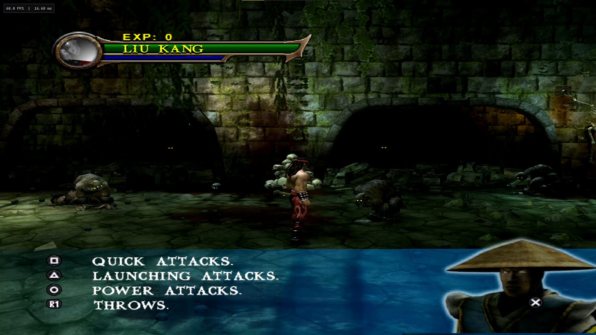
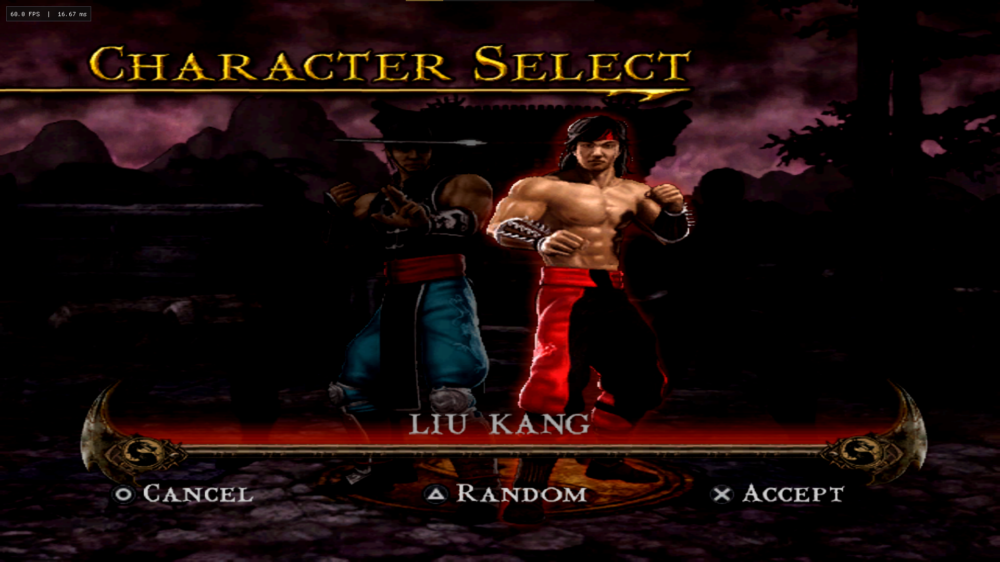
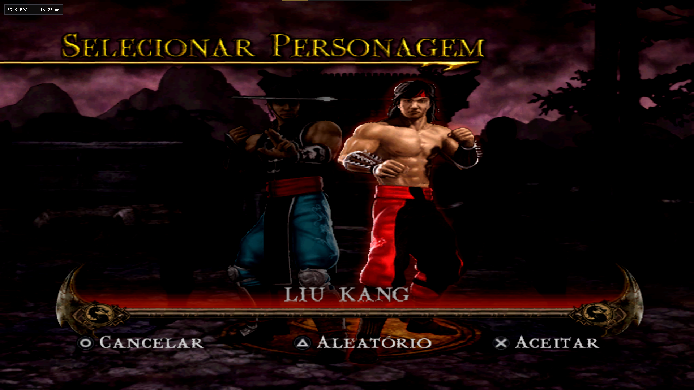
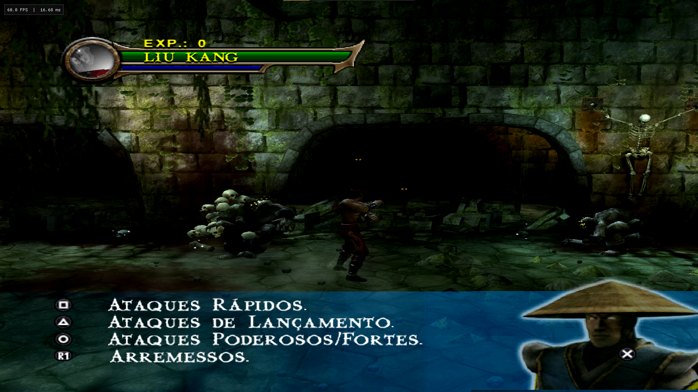
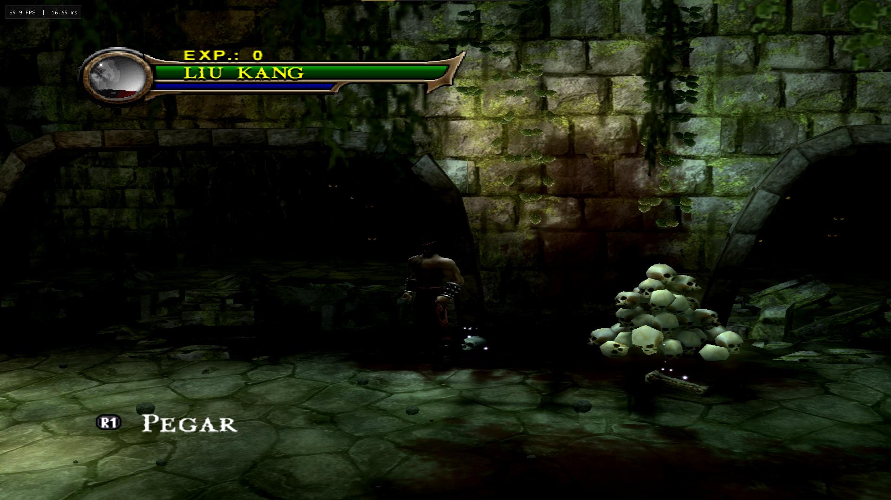
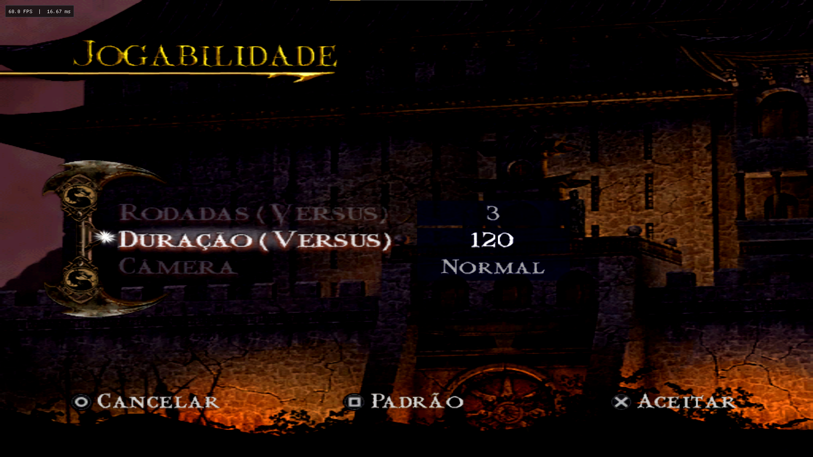
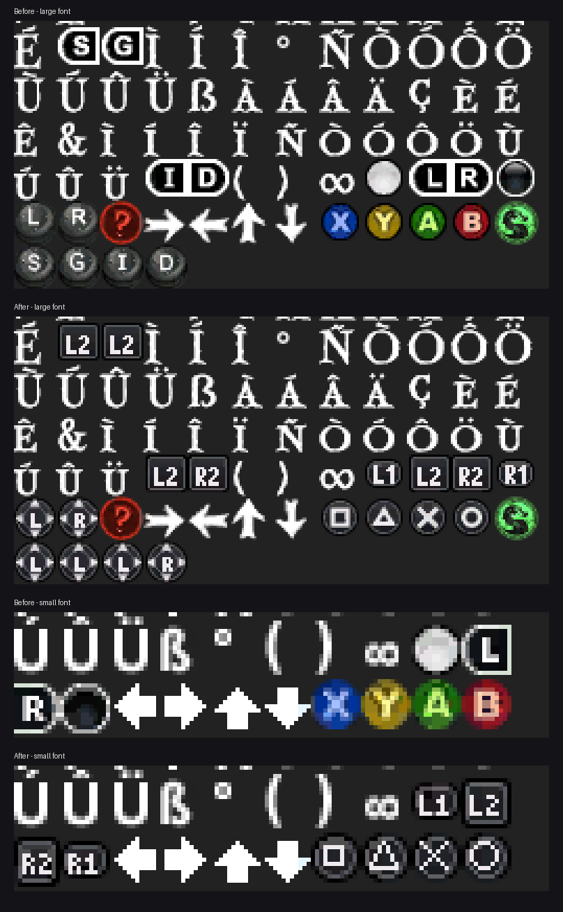
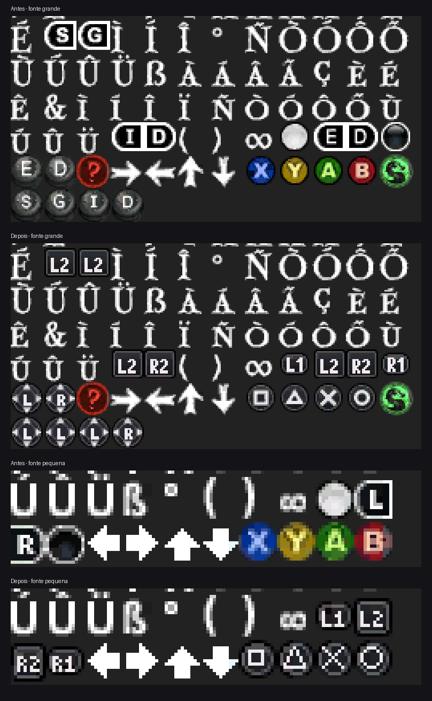

# DualSense Prompts for Shaolin Monks Recomp

Replaces the Xbox button icons in [Shaolin Monks Recomp](https://github.com/OAleex/ShaolinMonksRecomp) with DualSense (PS5) prompts: light symbols on a dark button.

[**Português (Brasil)**](#português-brasil) · [Download](../../releases/latest)



## Screenshots

| English | Português (Brasil) |
| --- | --- |
|  |  |
|  |  |
| |  |
| |  |

## Versions

| Game language | File | Install |
| --- | --- | --- |
| English | `DualSensePrompts_EN-1.1.0.tar.xz` | Launcher: **Mods > Install from file...** |
| Brazilian Portuguese | `DualSensePrompts_PT-BR-1.1.0.zip` | Copy the two fonts, or run `Instalar.bat` |

Both versions can stay installed together. Each one applies only to its own language.

## Mapping

It matches the Recomp's default controller mapping.

| Xbox | DualSense |
| --- | --- |
| A / B / X / Y | Cross / Circle / Square / Triangle |
| White / Black | L1 / R1 |
| Left / Right trigger | L2 / R2 |
| Left / Right stick | Tilted stick, L or R with arrows |

The game names the grey icons "Left Analog Stick" and "Right Analog Stick" and uses them for tilting the stick, as in running attacks. They show the stick, not L3 or R3.
D-pad arrows, the `?` icon and the dragon logo are unchanged.



## English

Requires Shaolin Monks Recomp 0.2.0 or later and the supported USA/Europe Xbox game.

1. Select **English** as the game language in the launcher.
2. Open **Mods** and select **Install from file...**.
3. Choose `DualSensePrompts_EN-1.1.0.tar.xz`.

Disable or remove the mod in **Mods** to restore the Xbox icons.

The package is a language pack for English. It applies only when the game language is English, so it can stay enabled together with LanguagePack PT-BR.
A regular texture mod would conflict with LanguagePack PT-BR, because both replace the game's fonts.

## Português (Brasil)

Requer o **LanguagePack PT-BR 2.0.0** instalado e ativado.

As fontes do LanguagePack ficam na pasta de dados do Recomp: veja o campo **Data folder** na aba **Files and support** do launcher. O padrão é `C:\Users\<seu usuário>\AppData\Local\Shaolin Monks Recomp`.

**Instalação manual (recomendada)**

1. Feche o jogo e o launcher.
2. Abra `<Data folder>\mods\languages\LanguagePack_PT-BR\fonts`.
   Atalho: cole `%LOCALAPPDATA%\Shaolin Monks Recomp\mods\languages\LanguagePack_PT-BR\fonts` na barra do Explorador de Arquivos.
3. Copie `small.xpr` e `large.xpr` para fora da pasta do Recomp, como backup.
4. Copie `small.xpr` e `large.xpr` da pasta `fonts` do zip para essa pasta, substituindo os arquivos.
5. Abra o launcher e jogue em Português (Brasil).

Para desfazer, coloque os arquivos do backup de volta.

**Instalação automática (opcional)**

`Instalar.bat` faz os mesmos passos: acha a pasta, faz backup e confere as fontes por SHA-256. Se não achar a pasta, ele pede o endereço do Data folder. Para desfazer, use `Desinstalar.bat`.

Atualizar o LanguagePack PT-BR pelo launcher volta os ícones do Xbox. Repita a instalação depois de uma atualização.



## How it works

- The button icons are glyphs in the game's two fonts, `small.xpr` and `large.xpr`. Each is an XPR0 resource with one DXT5 texture.
- The tools redraw only the icon cells. They re-encode only the 4x4 DXT5 blocks that touch them: 91 in the small font and 533 in the large font.
- The XPR0 header, the file size and every other byte stay identical, as the runtime requires.
- How each version is distributed:
  - the English package stores xdelta patches against `default.xbe`;
  - the PT-BR version ships the LanguagePack PT-BR fonts with only the icon blocks changed, plus an optional installer that applies just those blocks.

### Tools

Requires Python 3.10+, `numpy` and `pillow`.

```
python tools/build_dualsense.py <folder with small.xpr and large.xpr> <output folder>
python tools/make_ptbr_installer.py <LanguagePack PT-BR fonts> <output fonts> <installer folder>
```

The English package is built with the [Krypt builder](https://github.com/OAleex/ShaolinMonksRecompKrypt). Its catalog entry is in `krypt/mods.json-entry.json`.

## Credits

- **DualSense Prompts:** Fábio
- **[Shaolin Monks Recomp](https://github.com/OAleex/ShaolinMonksRecomp):** OAleex
- **LanguagePack PT-BR** ([OAleex Traduções](https://oaleextraducoes.com/posts/2023/10/Mortal-Kombat-Shaolin-Monks/mortal-kombat-shaolin-monks-xbox/)). The PT-BR version is built on its fonts.
  - Translation, dubbing direction, editing, ROM hacking and tools: Alex "OAleex" Félix
  - Additional tools: Raynê Duarte, Mumm-Ra (STR Brasil), Thealexbarney
  - The full voice cast is in the LanguagePack's `CREDITS.md`.

This project is not affiliated with or endorsed by the owners of Mortal Kombat, Xbox or PlayStation.
